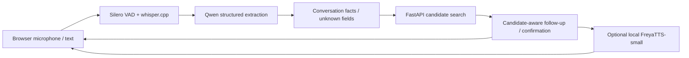

# Turkish Real Estate Voice Assistant

A local voice-assistant prototype for a real-estate office. It helps identify the property a caller saw on **Sahibinden** or on a physical **banner**, then collects a temporary callback summary.

Built by **Mehdi Heydari** as an applied-AI project: local speech recognition and synthesis, structured LLM extraction, conversational search, and multi-turn dialogue management.

**Status:** browser-microphone prototype with fictional listings. No phone-line connection, real office database, WhatsApp delivery, or production deployment is included. Ambiguous calls can remain unresolved; identifying a property is not guaranteed.

## What it does

- Accepts Turkish speech through a browser microphone, or text through the test panel.
- Extracts listing IDs, source, consultant, location, transaction/property type, room layout, floor and other clues.
- Looks up exact listing IDs or ranks candidates using transparent, heuristic field scores.
- Preserves facts and unknown answers across turns; asks questions based on differences between remaining candidates.
- Requests explicit property confirmation and collects callback details in temporary browser state.
- Optionally speaks replies using FreyaTTS-small. The browser page also includes an interactive explanation at `/flow`.

## Native installation on macOS

The installer keeps **all downloaded models, third-party code, virtual environments, builds and logs under ignored `.local/`**. None of those assets belong in Git. Upstream C++ source and model revisions are recorded in `assets.lock.json`; model downloads are checked against SHA-256 and byte size.

First installation needs internet access and several GB of free disk space. Base model downloads are about **4.1 GB**; adding TTS brings model downloads to about **5.2 GB**, before Python dependencies and build files. The application uses local assets at runtime; installation is not an air-gap certification.

Prerequisites:

- macOS, Python **3.12**, Git, CMake and Apple command-line build tools.
- Apple Silicon is the intended Metal target. A CPU profile is available for comparison and troubleshooting.
- Node.js is only required to run the JavaScript regression checks.

For example, if you already use Homebrew:

```sh
xcode-select --install                  # only if the Apple tools are missing
brew install python@3.12 cmake
```

Clone this repository, enter its directory, then:

```sh
PYTHON=python3.12 ./setup.sh --dry-run   # inspect the plan; changes nothing
PYTHON=python3.12 ./setup.sh             # voice input + text replies
PYTHON=python3.12 ./setup.sh --with-tts  # also install local spoken replies
PYTHON=python3.12 ./run.sh
```

Open **http://127.0.0.1:8766**. Enable the microphone only when ready to test; enable spoken replies separately if TTS was installed. Keep the launcher terminal open. Use **Ctrl+C** or `./stop.sh` from another terminal to stop this installation. `./status.sh` reports service readiness; model loading can take time.

```sh
PYTHON=python3.12 ./status.sh
PYTHON=python3.12 ./stop.sh
python3.12 scripts/assistant.py verify  # verify installed model checksums
```

No `sudo`, system service registration, phone account, paid API or remote inference provider is configured by the installer. It does not remove an existing demo or kill services occupying its ports.

### Acceleration and troubleshooting

`--backend auto` chooses Metal on Apple Silicon and CPU otherwise. Set it explicitly when needed:

```sh
PYTHON=python3.12 ./setup.sh --backend cpu
PYTHON=python3.12 ./setup.sh --backend metal --with-tts --tts-device mps
```

TTS defaults to CPU; the MPS option needs testing on the target machine. Native execution permits direct access to supported acceleration, but does not guarantee a particular latency. Metal initialization failed on an earlier development setup, so measure the selected profile rather than assuming it works everywhere.

If ports 8766, 8768, 8769 or 8770 are occupied, stop the old demo before launching this installation. Logs are in `.local/run/`. The installer requires a full successful run before writing its settings. Interrupted downloads are not installed as valid assets; rerunning installation verifies and reuses completed files.

This first installer targets macOS. **Linux/Windows installation and unattended office deployment have not been validated.**

Installer validation currently covers the lightweight checks and dry-run plan. A complete first-time native build, multi-GB asset installation and audio session on a clean Mac have not yet been verified end to end.

## Architecture



| Component | Technology | Local port |
|---|---|---|
| Browser + speech input | FastAPI, Silero ONNX, whisper.cpp / large-v3-turbo | 8766 |
| Language model | llama.cpp, Qwen3-4B-Instruct-2507 Q4_K_M | 8768 |
| Portfolio search | FastAPI, fictional JSON records | 8769 |
| Optional speech output | FreyaTTS-small, PyTorch, AudioVAE2 | 8770 |

Services bind to loopback. CORS permits the local demo origin; this is not a public, authenticated multi-tenant service. Models and dependencies download during setup, not into the Git repository. The original model/runtime implementations are maintained by their upstream authors.

## Engineering decisions and limits

- Exact listing number lookup takes priority over similarity scoring.
- Scores are heuristic contributions, **not calibrated probabilities**. A score of 65 is not a measured 65% chance of correctness.
- Unknown answers and previous questions constrain follow-up choices. A structured field identifier is validated before accepting an LLM-generated question.
- No eligible follow-up is a valid outcome. More questions cannot recover information the caller does not have.
- Callback details currently live only in browser memory; refreshing clears them. No real consultant is notified. Some dialogue copy simulates a completed callback flow and must not be treated as an actual delivery receipt.
- Speech processing is not fully streaming end to end: Whisper runs per completed utterance and FreyaTTS returns a complete WAV before playback. Multi-turn extraction and question selection can make two sequential model requests. Latency still needs stage-by-stage measurement.
- PostgreSQL/pgvector, RAG, RabbitMQ, telephony and notification delivery are future work, not implemented features.

See [architecture notes](docs/architecture.md), [third-party sources](THIRD_PARTY_NOTICES.md) and the [initial text evaluation](docs/initial-text-evaluation.md).

## Verification

```sh
python3.12 -m unittest discover -s tests -p 'test_*.py' -v
node --test tests/dialogue.test.cjs
```

The lightweight checks use temporary files and mocked services. They do not download models or measure speech/LLM accuracy. The historical 20-scenario report is an initial text-only baseline, not an updated release score or production benchmark.
